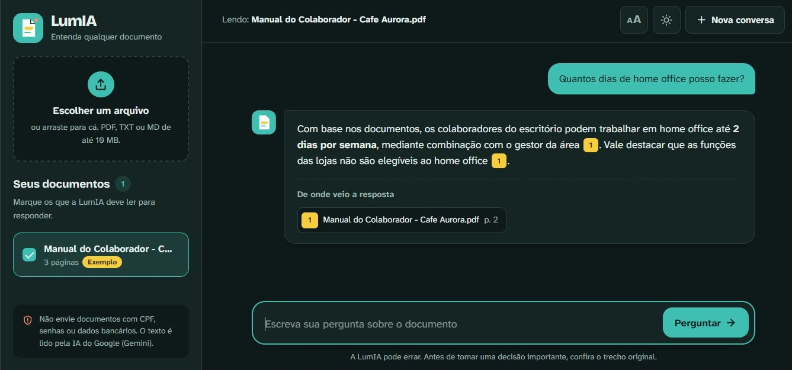
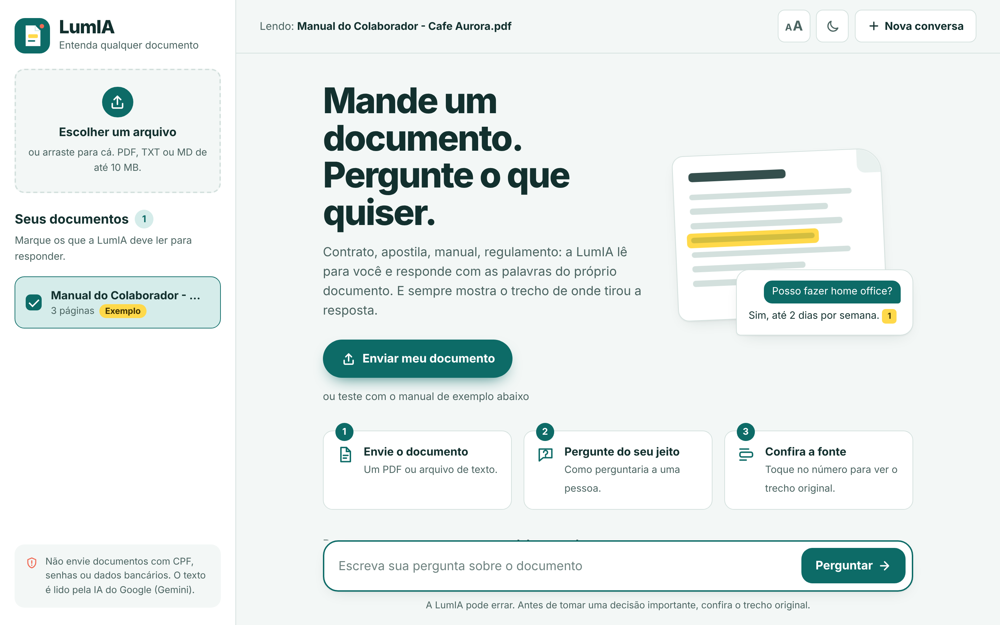
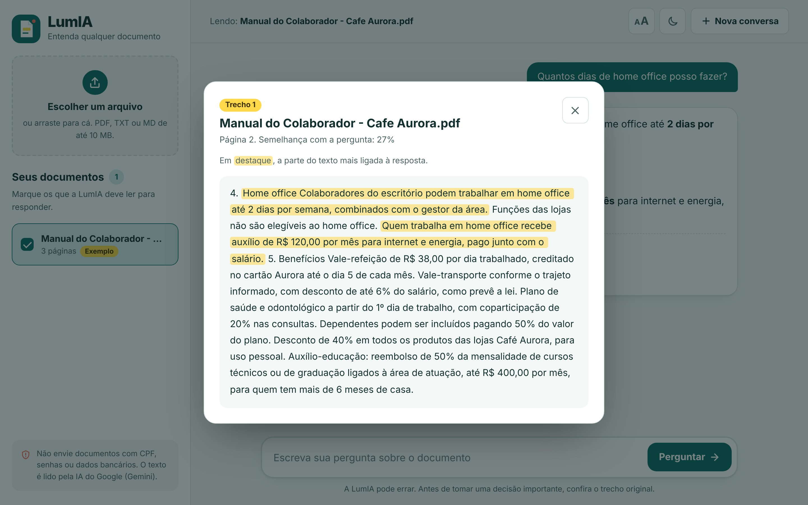
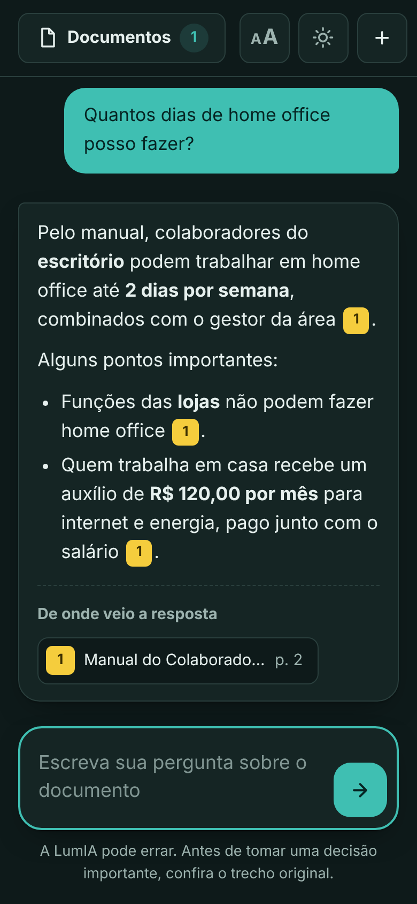

# 💡 LumIA: entenda qualquer documento

**LumIA** é uma aplicação web de **IA generativa com RAG** (*Retrieval-Augmented Generation*). Você envia um PDF, como um contrato, uma apostila ou um manual, e faz perguntas em linguagem natural. A IA responde usando **apenas o conteúdo do documento** e mostra **de onde tirou cada informação**, com o documento, a página e o trecho original.



| Tela inicial | Trecho de origem | Celular (tema escuro) |
|---|---|---|
|  |  |  |

## ✨ Funcionalidades

- Upload de **PDF, TXT ou MD** (arraste e solte ou clique)
- Perguntas em linguagem natural sobre um ou vários documentos ao mesmo tempo
- Respostas com **citações clicáveis** [1] [2] que abrem o trecho original
- Perguntas de continuação ("e quem trabalha nas lojas?") usando o histórico da conversa
- A IA diz quando a resposta **não está** no documento, em vez de inventar
- Cada visitante tem seu próprio espaço: ninguém vê os documentos de outra pessoa
- Documento de exemplo para testar na hora (manual de uma empresa fictícia)
- Limites de uso para proteger a cota gratuita da API
- Tema claro e escuro, e botão para aumentar o texto (pensado para pessoas de qualquer idade)
- Ao abrir uma fonte, a frase usada na resposta aparece destacada, como um marca-texto
- Layout responsivo (computador e celular), navegação por teclado e respeito à preferência de menos animação

## 🧠 Como funciona o RAG

```
          PREPARAÇÃO (no upload)                        PERGUNTA
  ┌──────────┐   ┌──────────┐   ┌────────────┐     ┌────────────┐
  │   PDF    │ → │ trechos  │ → │ embeddings │     │  pergunta  │
  └──────────┘   │ ~1000 c. │   │ (vetores)  │     └─────┬──────┘
                 └──────────┘   └─────┬──────┘           │ embedding
                                      │   similaridade   ▼
                                      └──── de cosseno ──► 6 trechos mais parecidos
                                                                │
                                         Gemini responde usando ▼ só esses trechos + cita as fontes
```

1. **Leitura:** o texto de cada página é extraído com `pypdf`.
2. **Divisão em trechos:** o texto é cortado em pedaços de ~1000 caracteres, sem quebrar frases, com uma sobreposição de 200 caracteres para não perder o contexto entre um trecho e outro.
3. **Embeddings:** cada trecho vira um vetor de 768 números que representa o seu **significado** (modelo `gemini-embedding-2`). Os vetores ficam salvos no SQLite.
4. **Busca:** a pergunta também vira um vetor, e o app calcula a **similaridade de cosseno** com todos os trechos usando `numpy`. A busca foi implementada do zero, sem banco vetorial pronto, para deixar claro como ela funciona.
5. **Geração:** os trechos mais parecidos vão para o modelo Gemini (o "flash" mais recente disponível no plano gratuito), com instruções para responder **só** com base neles e citar as fontes.

## 🛠️ Tecnologias

| Camada | Tecnologias |
|---|---|
| Back-end | Python, Flask |
| IA | Google Gemini API (embeddings + geração), chamada via REST |
| Busca vetorial | NumPy (similaridade de cosseno) |
| Leitura de documentos | pypdf |
| Banco de dados | SQLite |
| Front-end | HTML, CSS, JavaScript (Fetch API), sem frameworks |

## 🏗️ Arquitetura

```
app.py         → rotas da página e da API, sessões e limites de uso
documentos.py  → leitura do PDF, divisão em trechos, indexação e busca
ia.py          → cliente da API do Gemini (embeddings, geração, escolha do modelo)
database.py    → tabelas de documentos, trechos (com vetores) e uso
```

| Método | Rota | Descrição |
|---|---|---|
| GET | `/api/documentos` | Lista os documentos do visitante + o exemplo |
| POST | `/api/documentos` | Envia e indexa um documento |
| DELETE | `/api/documentos/<id>` | Exclui um documento |
| POST | `/api/perguntar` | Busca os trechos e gera a resposta com fontes |

## 🚀 Como rodar

```bash
git clone https://github.com/Silvaxzy/lumia.git
cd lumia

python -m venv venv
venv\Scripts\activate        # Windows
source venv/bin/activate     # Linux/Mac

pip install -r requirements.txt
```

Crie uma chave gratuita em [aistudio.google.com](https://aistudio.google.com), copie o arquivo `.env.example` para `.env` e preencha:

```
GEMINI_API_KEY=sua-chave
SECRET_KEY=uma-frase-secreta-longa
```

```bash
python app.py
```

Acesse **http://127.0.0.1:5000**.

> Para testar sem gastar a cota da API, rode com `IA_FALSA=1`: as respostas são simuladas.

### Deploy (Render)

- **Build:** `pip install -r requirements.txt`
- **Start:** `gunicorn app:app --timeout 120`
- **Variáveis:** `GEMINI_API_KEY`, `SECRET_KEY`

## 🔒 Privacidade

No plano gratuito, o Google pode usar o conteúdo enviado para melhorar seus produtos. Por isso, **não envie documentos com dados pessoais ou sigilosos** para a demonstração. Os documentos enviados por visitantes são apagados automaticamente depois de 7 dias.

## 📌 Próximas melhorias

- [ ] Leitura de PDFs escaneados (OCR)
- [ ] Resposta em tempo real, palavra por palavra (streaming)
- [ ] Busca híbrida (palavras-chave + significado)
- [ ] Avaliação automática da qualidade das respostas

## 👤 Autor

Feito por **Bruno Silva**, estudante de Análise e Desenvolvimento de Sistemas.

[GitHub](https://github.com/Silvaxzy) · [LinkedIn](https://www.linkedin.com/in/bruno-silva-2846192aa) · [Portfólio](https://silvaxzy.github.io)
